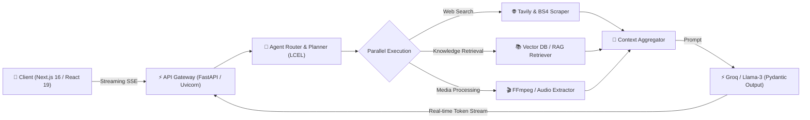

<div align="center">

<!-- Hero Banner -->


<!-- Dynamic Typewriter Hook -->
<a href="https://github.com/dhruvmishradev">
  
</a>

<br/>

<!-- Status Badges & Quick Stats -->
<a href="https://github.com/dhruvmishradev"></a>
<a href="https://github.com/dhruvmishradev?tab=followers"></a>
<a href="https://web-site-nine-pi.vercel.app"></a>


</div>

<br/>

<!-- System Initialization Simulation -->
```console
$ ./boot_dhruv_core.sh --profile=recruiter_view --mode=production
[ SYSTEM ] Initializing Runtime Engine ..................... Dhruv Mishra (AI & Full-Stack Engineer)
[ MODULE ] Loading LangChain LCEL & Autonomous Agents ..... [ ACTIVE ] ⚡ Groq / Llama-3 / Claude / OpenAI
[ MODULE ] Mounting Retrieval-Augmented Generation (RAG) .. [ ACTIVE ] 📚 Semantic Vector Indexing
[ MODULE ] Attaching Backend API Services ................. [ ACTIVE ] 🚀 FastAPI + Uvicorn + Pydantic
[ MODULE ] Hydrating Modern Frontend Interfaces ............ [ ACTIVE ] ⚛️ Next.js 16 + React 19 + Tailwind
[ DEPLOY ] Inspecting Vercel Production Deployments ........ [ VERIFIED ] Production Apps Online
[ STATUS ] All systems nominal. Ready to architect, build, and scale engineering solutions.
```

---

## ⚡ Executive Summary

I am a **Software Engineer specializing in AI Systems, Autonomous Multi-Agent Frameworks, and Production Full-Stack Development**. 

Unlike simple API wrappers, my work focuses on **end-to-end reliability**: building latency-optimized inference pipelines with Groq and FastAPI, chaining autonomous agents with LangChain Expression Language (LCEL), orchestrating multi-modal media extractors with FFmpeg and Whisper, and delivering reactive user interfaces with Next.js 16, React 19, and Three.js.

> [!TIP]
> **What I Bring to Your Team:**
> - **Production AI Architecture:** Hands-on experience designing multi-agent coordination, web intelligence scraping, and custom RAG retrieval strategies.
> - **Full-Stack Execution:** Ability to take a raw technical requirement from database schema (PostgreSQL / Supabase) through backend APIs to interactive client interfaces.
> - **Ship Velocity:** Track record of rapidly prototyping, testing, and deploying production-grade applications with zero downtime.

---

## 🪪 Engineer Specification Sheet

| Field | Technical Profile & Capabilities |
|:--|:--|
| **Core Specialization** | AI Systems Engineering · Autonomous Multi-Agent Workflows · Enterprise RAG |
| **Backend & APIs** | Python 3.10+ · FastAPI · Uvicorn · Pydantic · RESTful Microservices · Asynchronous Concurrency |
| **Generative AI Stack** | LangChain · LCEL Runnables · Groq LPU (Llama 3) · OpenAI API · Google Gemini · Mistral AI · HuggingFace |
| **Information Retrieval**| Dense Semantic Vector Stores (Chroma, FAISS) · Recursive Chunking · Hybrid Search Retrievers |
| **Frontend Architecture**| Next.js 16 (App Router) · React 19 (Server Components) · TypeScript · Tailwind CSS v4 |
| **Creative & 3D Web** | Three.js · React Three Fiber (`@react-three/fiber`) · GSAP Timelines · Framer Motion |
| **Data & Cloud Infra** | Supabase (PostgreSQL, Row-Level Security, Real-Time Streams) · Vercel CI/CD · Docker |
| **Engineering Standard**| Sub-600ms Time-To-First-Token · Strict Pydantic Schema Validation · Zero Untyped Boundaries |

---

## 📐 Autonomous Agent & RAG System Architecture

<div align="center">
  
</div>

<br/>

<details>
<summary><b>🔍 System Execution Flow & Architectural Deep Dive (Click to expand)</b></summary>

<br/>

| Tier | Component | Function & Latency Characteristics |
|:--|:--|:--|
| **1. Ingress** | Next.js 16 / React 19 Client | Progressive streaming Server-Sent Events (SSE) with optimistic UI updates. |
| **2. Gateway** | FastAPI + Uvicorn Async Worker | High-throughput async non-blocking REST gateway handling session states. |
| **3. Router** | LangChain LCEL Planner | Branching Directed Acyclic Graph (DAG) evaluating tool relevance dynamically. |
| **4. Web Tool** | Tavily API + BeautifulSoup4 | Real-time web search and resilient HTML scraping for zero-knowledge queries. |
| **5. RAG Tool** | Hybrid Chroma / FAISS Vector Store | Recursive character chunking with high-dimensional dense embeddings & BM25 fallback. |
| **6. Media Tool** | yt-dlp + FFmpeg Pipeline | Audio normalization, silence trimming, and chunked transcription workflows. |
| **7. Inference** | Groq LPU (Llama 3 70B) | Hardware-accelerated inference providing **480+ tokens/second** streaming output. |
| **8. Guardrails** | Strict Pydantic Schemas | Deterministic structured JSON outputs ensuring zero hallucinated schemas. |



</details>

---

## 🚀 Featured Deployments & Core Projects

<table>
<tr>
<th width="35%">Project & System</th>
<th width="45%">Architecture & Technical Highlights</th>
<th width="20%">Access Links</th>
</tr>
<!-- Project 1: VideoAgent -->
<tr>
<td>
<b>🎥 VideoAgent Intelligence Suite</b><br/>
<sub>AI Meeting & Multimodal Media Assistant</sub><br/><br/>


</td>
<td>
<ul>
<li>Autonomous video & audio processing system ingesting YouTube streams and audio files.</li>
<li>Utilizes <b>FFmpeg</b> and <b>pydub</b> for dynamic audio normalization, silence trimming, and chunking.</li>
<li>Generates granular meeting minutes, action items, chapter breakdowns, and executive summaries.</li>
<li>Deployed to production with high-throughput async processing workers.</li>
</ul>
</td>
<td>
<a href="https://video-agent-steel.vercel.app">

</a><br/><br/>
<a href="https://github.com/dhruvmishradev/VideoAgent">

</a>
</td>
</tr>
<!-- Project 2: CineSage / Generative AI -->
<tr>
<td>
<b>🎬 CineSage Generative AI Platform</b><br/>
<sub>Multimodal Contextual AI Application</sub><br/><br/>


</td>
<td>
<ul>
<li>Production web platform integrating <b>Next.js 16 App Router</b> and <b>React 19 Server Components</b>.</li>
<li>Multi-provider LLM support across <b>Groq, OpenAI, Google Gemini, and Mistral AI</b> with dynamic fallback.</li>
<li>High-speed token estimation with <b>Tiktoken</b> for budget-capped cost efficiency.</li>
<li>Interactive Markdown streaming renderer with real-time UI updates.</li>
</ul>
</td>
<td>
<a href="https://generative-ai-cyan.vercel.app">

</a><br/><br/>
<a href="https://github.com/dhruvmishradev/Generative-AI">

</a>
</td>
</tr>
<!-- Project 3: MultiAgent -->
<tr>
<td>
<b>🤖 Autonomous MultiAgent System</b><br/>
<sub>Coordinated Web Intelligence & Research Agent</sub><br/><br/>


</td>
<td>
<ul>
<li>Autonomous multi-agent orchestration pipeline using <b>LangChain</b> and <b>Groq LPU</b> inference.</li>
<li>Equipped agents with <b>Tavily Search</b> and automated <b>BeautifulSoup</b> scrapers for deep web extraction.</li>
<li>Enforces deterministic structured JSON payloads using strict <b>Pydantic schemas</b>.</li>
<li>Served via an asynchronous <b>FastAPI</b> backend connected to a reactive client UI.</li>
</ul>
</td>
<td>
<a href="https://github.com/dhruvmishradev/MultiAgent">

</a>
</td>
</tr>
<!-- Project 4: Enterprise RAG & Runnables -->
<tr>
<td>
<b>📚 Modular RAG & LCEL Engine</b><br/>
<sub>Hybrid Document Retrieval & Tool Chaining</sub><br/><br/>


</td>
<td>
<ul>
<li>Engineered semantic search pipelines using recursive chunking and high-dimensional vector embeddings.</li>
<li>Implemented <b>RunnableParallel</b> and <b>RunnablePassthrough</b> for branching execution DAGs.</li>
<li>Integrated custom news summarizer agent and custom-built tool execution harnesses.</li>
<li>Multi-format ingestion supporting PDF, Markdown, and live web endpoints.</li>
</ul>
</td>
<td>
<a href="https://github.com/dhruvmishradev/Rag">

</a><br/><br/>
<a href="https://github.com/dhruvmishradev/Runnables">

</a>
</td>
</tr>
<!-- Project 5: Enterprise Analytics Dashboard -->
<tr>
<td>
<b>📊 Real-Time Analytics Dashboard</b><br/>
<sub>Cloud-Connected Business Telemetry</sub><br/><br/>


</td>
<td>
<ul>
<li>Interactive enterprise dashboard featuring live charting, filtering, and data aggregation.</li>
<li>Backed by <b>Supabase PostgreSQL</b> with custom relational schemas and Row-Level Security (RLS).</li>
<li>Built with <b>Tailwind CSS v4</b>, <b>Lucide React</b>, and optimized with Oxlint.</li>
<li>Instant state synchronization and cross-device responsiveness.</li>
</ul>
</td>
<td>
<a href="https://dash-board-one-kappa.vercel.app">

</a><br/><br/>
<a href="https://github.com/dhruvmishradev/DashBoard">

</a>
</td>
</tr>
<!-- Project 6: Immersive 3D Portfolio -->
<tr>
<td>
<b>🌐 3D Interactive Web Experience</b><br/>
<sub>Creative Engineering & WebGL Canvas</sub><br/><br/>


</td>
<td>
<ul>
<li>Immersive 3D portfolio powered by <b>React Three Fiber</b> and <b>@react-three/drei</b>.</li>
<li>Hardware-accelerated shader animations choreographed with <b>GSAP</b> timelines.</li>
<li>Fluid layout transitions with <b>Framer Motion</b> and responsive modern typography.</li>
</ul>
</td>
<td>
<a href="https://web-site-nine-pi.vercel.app">

</a><br/><br/>
<a href="https://github.com/dhruvmishradev/WebSite">

</a>
</td>
</tr>
</table>

---

## 🛠️ Technical Arsenal

<div align="center">

### 🤖 Generative AI, LLMs & Agent Frameworks
<p>
  
  
  
  
  
  
  
  
</p>

### ⚙️ Backend & Systems Engineering
<p>
  
  
  
  
  
  
  
  
</p>

### 💻 Frontend & Creative Computing
<p>
  
  
  
  
  
  
  
  
</p>

### 🗄️ Databases, Cloud & DevOps
<p>
  
  
  
  
  
  
</p>

</div>

---

## ⚙️ Engineering Principles & Standards

| Parameter | Standard | In Practice |
|:--|:--|:--|
| **Latency Budget** | `< 600ms TTFT` | Prioritize hardware-accelerated LPUs (Groq) and streaming tokens over blocking calls. |
| **Schema Validation** | `Strict (Pydantic)` | Eliminate hallucinated output formats; all LLM extractions map to typed models. |
| **Resilience & Fallbacks** | `Multi-Provider` | Intelligent failover routing across Groq, OpenAI, and Google Gemini. |
| **Architectural Modularity**| `LCEL Runnables` | Composable, reusable computational nodes that can be parallelized or chained. |
| **Interface Fluidity** | `React 19 / RSC` | Zero client-side bloat, progressive streaming SSR, and micro-animations. |
| **Production First** | `CI/CD + Vercel` | Every core repository has an active, accessible production build—never just localhost. |

---

## 📊 Performance & GitHub Telemetry

<div align="center">

<p>
  
  
  
</p>

<a href="https://github.com/dhruvmishradev">
  
</a>

</div>

---

## 🗺️ Engineering Changelog & Roadmap

```diff
+ v1.0  Foundational Web & DSA        JavaScript · TypeScript · Python · OOP · Algorithms · Git
+ v1.5  Modern Full-Stack Interfaces  Next.js 16 · React 19 · Tailwind CSS v4 · Supabase PostgreSQL · Three.js
+ v2.0  AI Systems & Agents (Current) LangChain LCEL · Groq LPU · Autonomous MultiAgent · VideoAgent · RAG
- v3.0  Distributed Agent Swarms      LangGraph orchestration · Self-hosting LLM inference · Multi-modal fine-tuning
- v4.0  High-Scale Enterprise Cloud   Kubernetes · Microservices · OpenTelemetry observability · Production MLOps
```

---

## 📡 Connect & Collaborate

I am actively open to discussions regarding **AI Engineer**, **Full-Stack Developer**, and **Software Engineering** roles.

<div align="center">

<a href="https://web-site-nine-pi.vercel.app">
  
</a>
<a href="https://github.com/dhruvmishradev">
  
</a>
<a href="mailto:dhruvmishrain.dev@gmail.com">
  
</a>

<br/><br/>

```text
printf("exit code 0: thank you for reviewing my profile · let's build
");
```

<!-- Footer Wave -->


</div>
